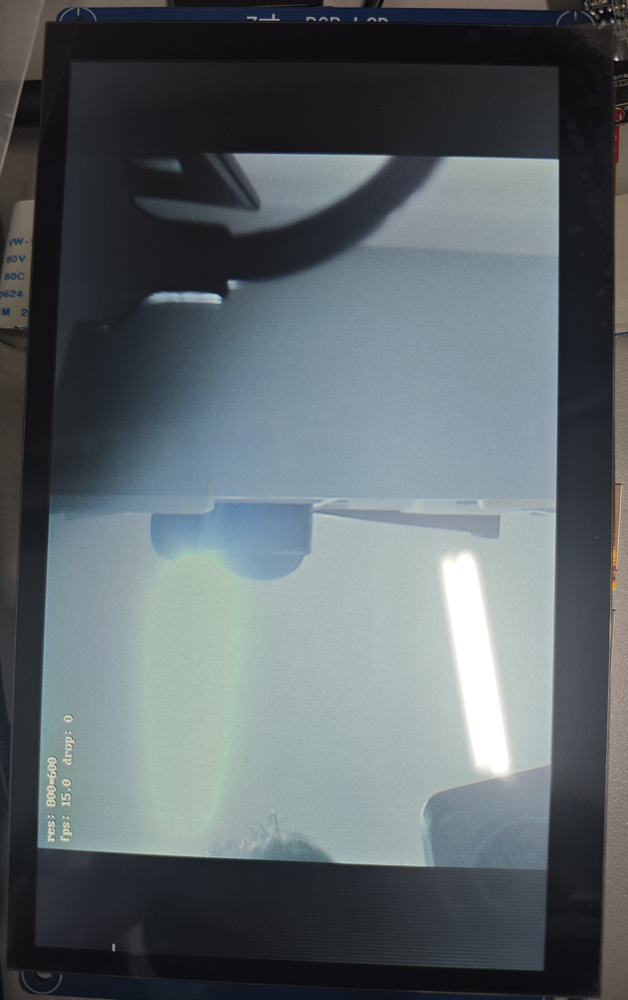
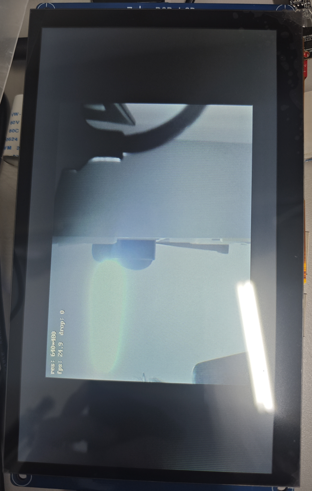

# 性能记录

> 这里只写我实际跑出来的数、跑的步骤，以及还没想明白的地方。

---

## 2026-11-08：连续预览跑满 10 分钟

### 怎么测的

- 板子 100ask i.MX6ULL，USB 摄像头 `/dev/video1`，800×600 YUYV；
- LCD `/dev/fb0`，1024×600，32bpp（`line_length = 4096`，`yres_virtual = 1200`）；
- 编译类型 RelWithDebInfo；
- 程序每秒往日志打一行：`fps / wait / conv / draw / dropped / rss`；
- 另开一个 shell 每 60 秒 `grep VmRSS`，用来对日志里的内存数。

### 一条典型输出

```text
fps: 15.0, wait: 0.7, conv: 35.1, draw: 30.6, dropped: 0, rss: 6324 kB
```

这行在 `lcd.log` 里，不在 `camera.log` 里——`lcd_init()` 会把日志重定向到 `lcd.log`，
这是现在的一个缺陷，见 README 的已知限制。

### 结果

跑了 604 秒，收尾打印 `DQbuf: 9036, Qbuf: 9036, Frames: 9036`。

- fps 稳态 15.0，逐秒在 14.8–15.2 之间；
- wait 0.7 ms；
- conv 35.1 ms；
- draw 30.6 ms；
- dropped 0；
- VmRSS 6324 kB，从第一秒到最后没动过。

### 这些数怎么读

帧周期是 66.7 ms（15 fps）。`0.7 + 35.1 + 30.6 = 66.4`，剩下的 0.3 ms 花在 QBUF、flip 和日志上。
也就是说 CPU 几乎整帧都在干活，真正闲着的只有 0.7 ms 的 wait 和 0.3 ms 的杂项。

去查摄像头参数：`v4l2-ctl --list-formats-ext` 里 800×600 YUYV只有 15 / 10 / 5 三档。

所以这组数的含义是“刚好跟得上”，不是“跑满了”。

### 开双缓冲前后的对比

单缓冲阶段测到的是一组 `wait 3.8 / conv 34.9 / draw 27.8`，加起来 66.5。
开了双缓冲之后 wait 掉到 0.7、draw 涨到 30.6，总和还是 66.5 左右。

draw 多出来的 2.8 ms 我到现在没找到确定原因。怀疑是交替写两块 2.4 MB 区域带来的
cache/TLB 差异，也可能只是两次构建之间的差别。以后用 perf 再看，现在不影响结论：
总时间由摄像头决定，帧率没变。

### 启动和抖动

- 第一帧等了约 1.6 秒（上一轮是 0.97 秒）。应该是摄像头启动加自动曝光收敛，跟代码无关。
  这个数对 v1.0 的“开机 3 秒出图”有直接影响，先记下来。
- 00:36:29 那一秒 fps 掉到 12.2、wait 10.5 ms，下一帧就恢复了，没丢帧。
  4 个 buffer 在这里起了作用，算是“为什么要 ≥3 个 buffer”的一个实证。

### 内存

VmRSS 全程 6324 kB。32 MB 的 framebuffer mmap 不计入 RSS（设备内存，没有 struct page），
这个数只反映堆、栈和代码段。

---

## 2026-11-09：W3 优化（800×600，锁频）

分三次改，每改完都上板量一次。**全程锁 `performance` governor**——不锁频的话 conv 会在
16–19 ms 之间跳，draw 会从 31 涨到 36，测出来的“优化效果”一半是噪声。

| 步骤 | conv | draw | 单帧忙 | 占 66.7 ms |
|---|---|---|---|---|
| v0.5 基线（浮点 + 逐像素） | 35.1 | 30.6 | 65.7 | 98% |
| 定点化 | 25.9 | 31.1 | 57.0 | 85% |
| 提色度项 + 内联 clamp + 去 memcpy | 14.0 | 30.9 | 44.9 | 67% |
| 按行写 framebuffer | **14.0** | **8.6** | **22.6** | **34%** |

最后一版的日志：

```text
fps: 15.0, wait: 43.9, conv: 14.0, draw: 8.6, dropped: 0, rss: 6064 kB
DQbuf: 927, Qbuf: 927, Frames: 927
```

几点观察：

- conv 停在 14 ms 而不是更低，怀疑是每对像素 6 次 `clamp()` 的条件分支误预测
  （像素值随机，分支方向随机）。再往下要么做无分支 clamp，要么查表，要么上 NEON，
  现在不划算。
- draw 8.6 ms 已经接近纯内存带宽的理论值（1.92 MB 写 + 1.44 MB 读，约 7 ms），基本到顶。
- wait 从 0.7 涨到 43.9，说明三分之二的时间在等摄像头——这正是想要的：CPU 有 66% 空闲，
  可以塞 OSD/JPEG 了。
- 这一版没有兼容 16bpp：`lcd_write_line_rgb888()` 遇到非 32bpp 直接返回 -1，
  调用方当成致命错误退出。换屏再补。

结论：**目的不是涨 fps（摄像头锁死 15），而是把 CPU 忙占比从 98% 压到 34%。**

---

## 2026-11-09：640×480@30 和 letterbox

800×600 那组数说明 CPU 还有 66% 空闲，于是把 `camera.ini` 改成 640×480 试了一次，
顺便验证这两刀优化到底有没有用。

### 640×480@30

```text
fps: 30.0, wait: 18.2, conv: 9.4, draw: 5.5, dropped: 0, rss: 4436 kB
DQbuf: 1847, Qbuf: 1847, Frames: 1847
```

和按像素比例的估算几乎一样（估 conv 9.0 / draw 5.5 / wait 18.5）。
`18.2 + 9.4 + 5.5 = 33.1`，周期 33.3 ms，账对得上。RSS 从 6064 降到 4436，
因为 `rgbbuf` 从 1.44 MB 变成了 0.92 MB。

这是这次优化唯一能“看见”的收益：同一份代码，换个分辨率就从 15 fps 变 30 fps。
800×600 那边不会变，因为摄像头在这个尺寸下只有 15 fps 一档。

### letterbox 之后，晃一下掉到 25 fps

居中显示跑起来后，前 20 秒是 30 fps，中间晃了一下镜头，掉到 25 fps 并且一直没回去：

```text
00:19:41  fps 30.0, wait 18.2, conv 9.4, draw 5.4
00:19:42  fps 25.7, wait 25.2, conv 8.2, draw 5.4
00:19:43  fps 24.9, wait 26.3, conv 8.4, draw 5.4
```

第一反应是代码出问题了，但看两个数就能排除：

- `dropped` 一直是 0，帧序号连续，没丢帧；
- `wait` 从 18.2 涨到 26.3，是我们在等摄像头，不是算不过来；
- `conv + draw` 只有 13.7 ms，离 40 ms 的周期远得很。

如果是程序慢，应该是 `wait ≈ 0` 而 `dropped` 飞涨，现在正好相反。
所以是摄像头自己降帧了。原因基本可以确定是 UVC 的自动曝光：晃镜头那一下画面变暗，
AE 把曝光时间拉长，超过 1/30 s 的帧间隔之后，驱动只能把帧率降到下一档 25 fps
（1/25 = 40 ms），正好等于 `26.3 + 8.2 + 5.5`。

这不是 bug，是“暗光下用帧率换曝光”。想在暗处锁住 30 fps 只能手动设曝光，画面会变黑。
掉帧后用 `v4l2-ctl -d /dev/video1 --get-parm` 应该能看到 25.000。

以后再遇到“帧率莫名掉到 25/20/15”，先看 `wait` 和 `dropped` 的方向，再去看 exposure，
别在代码里找。

---

## 2026-11-11：MJPEG 拍照跑通

预览用 YUYV，拍照时临时切成 MJPEG：

### 结果

连拍 5 次，5 张都能打开：

```text
snapshot: ./images/IMG_20261111_150740.jpg (17108 bytes, 502 ms)
snapshot: ./images/IMG_20261111_150752.jpg (17308 bytes, 467 ms)
snapshot: ./images/IMG_20261111_150803.jpg (16936 bytes, 468 ms)
snapshot: ./images/IMG_20261111_150816.jpg (17176 bytes, 480 ms)
snapshot: ./images/IMG_20261111_150828.jpg (17120 bytes, 501 ms)
```

一次 500 ms 大概是这么花的：

- 停流 + 切 MJPG + 起流：约 20 ms；
- 等第一帧 + 写文件（约 17 KB）：约 430 ms；
- 切回 YUYV + 设帧率 + 起流：约 20 ms。

写文件本身不到 1 ms，时间全花在“STREAMON 之后等第一个完整帧”上。

### 拍照对预览的影响

- 拍照那一秒 fps 掉到个位数，下一格就回到 30；
- `dropped` 始终是 0（重新起流后把 sequence 计数清零了）；
- VmRSS 从 4496 kB 变成 2128 kB 后不再变化。差值约 2.4 MB，正好是 4 个 YUYV buffer
  （4 × 614400），切流重映射后这些页不再计入 RSS，不是泄漏。

### 踩到的一个坑：2000 ms 的 poll 超时不够

有一次拍照恢复预览后，下一帧等了 2.6 秒才来：

```text
15:07:40.726  snapshot ... (502 ms)
15:07:43.351  fps: 0.3, wait: 2608.2, dropped: 0
```

主循环的 `poll(fds, 1, 2000)` 先超时一次、打了一条 WARN，再 poll 才拿到帧。
把超时改成 3000 ms 后警告消失——但这只是把阈值抬过了这次的 2.6 s，并没有解决他是2.6秒的问题。

根因是 UVC 在 STREAMON 后要等摄像头内部流水线稳定：开机首帧要 1.2 s，切格式后这次要 2.6 s，
都是同一类延迟，而且**波动很大**（上一轮同样的流程只等了 38 ms）。

之后修改代码，给“重启后的第一帧”单独一个宽限：

```c
int timeout_ms = (frames == 0) ? 5000 : 2000;
```

稳态保持 2000 ms，才能及时抓到真卡死；重启后的首帧给 5 s，避免把摄像头的启动延迟当成故障。

另外新增camera_set_fps_if_needed函数，只在需要时才改帧率：

- 如果切回 YUYV 后驱动保留了 30fps（实验表明大概率会保留），`G_PARM` 就会直接返回 1/30，跳过 S_PARM，2.6 秒的延迟也就没了。如果驱动真把帧率重置了，那这 2.3秒就是必须付的代价。

### 结论

拍照链路可用：5/5 成功、文件能打开、预览自动恢复、无内存增长。
`S_PARM` 的 EBUSY 也修掉了——现在恢复顺序是 `set_format → set_fps → start`，
日志里 `capture fps: 1/30` 出现在 `streaming` 之前。

---

## 2026-11-12：运行时分辨率切换

加了 `SIGUSR2` 触发，不用重启程序就能在 800×600 和 640×480 之间切。

### 一次切换的日志

```text
09:36:38.974  format: 640x480 fmt=0x56595559 bytesperline=1280 sizeimage=614400
09:36:39.543  res switch to 640*480 ( 616 ms)
```

616 ms 里包括：停流、`S_FMT` 换分辨率、重新 `REQBUFS` + `mmap`、起流、等第一帧、清屏。
和拍照走的是同一条 `stop → set_format → start` 路径。

切完立刻拍照也正常：

```text
09:36:52.601  format: 640x480 fmt=0x47504a4d     ← MJPG
09:36:53.007  snapshot: IMG_20261112_093652.jpg (17200 bytes, 459 ms)
```

### 两个分辨率的对比

| | 800×600 | 640×480 |
|---|---|---|
| 帧率 | 15 fps（摄像头上限） | 30 fps |
| conv | 14.0 ms | 9.4 ms |
| draw | 8.6 ms | 5.5 ms |
| wait | 43.9 ms | 18.3 ms |
| 单张 MJPEG 照片 | 23924–24220 B | 17044–17200 B |
| 拍照耗时 | 737–804 ms | 459–467 ms |

800×600 拍照慢一截，一部分是帧本来就大，一部分是切流后等首帧更久。

### 结尾又掉到 25 fps

```text
09:37:08  fps 29.6, wait 18.5
09:37:09  fps 24.9, wait 26.4
```

还是自动曝光的老问题：`dropped` 一直是 0，`wait` 变大，说明是摄像头主动降帧，不是丢帧。

### 局限性

- 目标分辨率硬编码成 `{640,480}`，靠 `SIGUSR2` 触发；

---

## 2026-11-12：OSD实时显示

osd显示正确，数据变化与LOG日志信息一致，日志各项数据表现正常、拍照延时与上述相差无几，demo如下：






---

## 2026-11-14：8 小时长跑

用 `scripts/soak_test.sh` 跑的：每 10 分钟拍一张、每 30 分钟切一次分辨率、每 60 秒记一次
内存/fd/温度/剩余空间。程序从前一晚 19:38 跑到第二天 03:38，中间没人管它。

### 结果

```text
soak end: elapsed=28804s snapshots=47 switches=15
images: 0 -> 47 (+47, expected +47)
errors=0 warnings=0 poll_timeouts=0 failed_lines=0
DQbuf: 610390, Qbuf: 610390, Frames: 610390
```

610390 帧、47 张照片、15 次分辨率切换，长跑期间没有一条 ERROR/WARN，
收尾三本账相等（启动时“分辨率被协商成 800×600”那条 WARN 在长跑开始之前，不计在内）。

### 指标

| 指标 | 8 小时 |
|---|---|
| 帧数 | 610390 |
| 平均帧率 | 21.2（随分辨率和曝光在 12.5–30 之间变） |
| VmRSS | 1472–6548 kB 之间来回，VmHWM 7104 kB，无上升趋势 |
| fd | 7，全程不变 |
| 温度 | 68.1–70.6 ℃ |
| 剩余内存 | 344.9 MB → 323.3 MB，中途有回收，不是直线下降 |
| rootfs | 少 4.9 MB = 日志 3.7 MB + 图片 1.2 MB |
| dropped | 41 帧（610390 的 0.0067%） |

### RSS 为什么在 1.5–6.5 MB 之间来回

每拍一次照、每切一次分辨率，程序都会 `STOP → REQBUFS(0) → REQBUFS(4)`。
新申请的 4 块 buffer 有时会被算进 RSS、有时不算（取决于驱动那条 mmap 路径），
所以 RSS 像台阶一样上下跳。看这种数不要看单点，看**下限**：
一晚上最低始终是 1472 kB，最高 6548 kB，没有逐次抬高，就说明没有累积。

### 切换和拍照耗时

| 动作 | 耗时 |
|---|---|
| → 640×480 | 617–629 ms |
| → 352×288 | 489–501 ms |
| → 800×600 | 1695–1763 ms |
| 拍照 @800×600 | 763–767 ms，33–34 KB |
| 拍照 @640×480 | 523–525 ms，24–25 KB |

切到 800×600 固定要 1.7 秒，比其他两个多 1 秒——像素多、USB 带宽要重新协商，
每次都是这个数，不是偶发。

### dropped 的 41 帧

前 30 分钟掉得比较集中（0→10），后面基本是每次切换后偶尔掉 1–2 帧。
0.0067% 可以接受；以后真要追零丢帧，得从曝光和 USB 带宽上找，不是代码问题。

### 结论

8 小时不掉线、不涨内存、不涨 fd、温度稳，v1.0 的“8 小时稳定”这条过了。

---

## 可选优化项

1. **转换直接写 framebuffer 行**：把 `yuyv_to_rgb()` 和 `lcd_write_line_rgb888()` 合成一遍，
   省掉 1.4 MB 的 `rgbbuf` 写 + 读，估计还能省 4–6 ms。但 CPU 已经 34%，优先级不高，
   而且拍照路径还需要 RGB888。
2. **conv 查表 / 无分支 clamp / NEON**：同样是锦上添花，等真的需要 1080p 再说。

注：**800×600 的 fps 由摄像头锁死，优化只换 CPU 余量**；
真正能体现收益的是 640×480@30。

---

## 测量方法备忘

- 计时用 `clock_gettime(CLOCK_MONOTONIC)`，不用 REALTIME；
- 每秒窗口：`t3 - last_t0 >= 1000ms` 时打印，打印完清零；
- `fps = 窗口帧数 × 1000 / 实际窗口毫秒`，不能固定除以 1000；
- 丢帧用 `buf.sequence` 差值算，驱动丢的帧会跳号；
- VmRSS 每秒读一次就够，读 `/proc/self/status`；每帧读纯属浪费；
- 测之前先看 CPU 频率，刚启动那几秒 conv 会从 90 ms 降到 35 ms，与调频相关，
  和代码没什么关系：`cat /sys/devices/system/cpu/cpu0/cpufreq/scaling_cur_freq`。

---

## 历史数据

v0.1 只有单帧，没有可比的 fps。上面“开双缓冲前后”里的单缓冲那组
（wait 3.8 / conv 34.9 / draw 27.8）就是 v0.5 早期版本的数。
